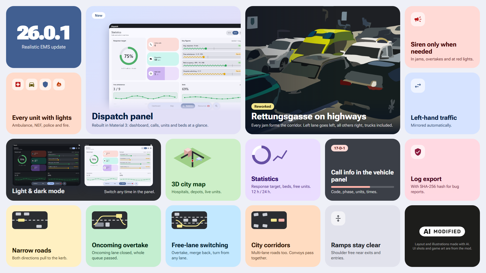

# Realistic EMS v26.0.2b: Rettungsgasse & Dispatch Panel

A big emergency-driving update: a reworked Rettungsgasse, new overtaking rules for narrow roads, and driving aids for every vehicle with blue lights. The dispatch panel now uses Material 3 and has a light and a dark mode.

> **Beta:** back up your saves before installing. Please report bugs on [GitHub Issues](https://github.com/BrickCraftLP/Realistic-EMS-CS2/issues) and attach the exported log.

## New

- **Rettungsgasse reworked**: on highways every traffic jam forms the corridor. On other multi-lane roads it forms as soon as an emergency vehicle comes. The left lane moves left and all other lanes move right, trucks included. Ramps stay clear near exits and entries, and several emergency vehicles in a row pass together.
- **Narrow roads** (one lane per direction): both directions pull to the kerb and the emergency vehicle drives on the centre line. If the road is too narrow, the queue turns off at the next junction.
- **Oncoming overtake**: if there are trucks or buses in the queue, the oncoming lane is closed and the whole queue is passed.
- **Every unit with lights**: all driving aids now work for ambulances, emergency doctor cars, police and fire brigade.
- **Siren only when needed** (option): lights stay on, and the siren only sounds in jams, while overtaking and at red lights.
- **Left-hand traffic**: cities that drive on the left are mirrored automatically.
- **Dispatch panel** in Material 3 with light and dark mode, plus a 3D city map.
- **Call info** (code, phase, units, times) in the selected vehicle panel.

## Changed

- **Export log** writes a SHA-256 hash file instead of a signature.

## AI disclosure

The preview images (layout and illustrations) were made with AI. The UI screenshots and game art come from the mod itself.
